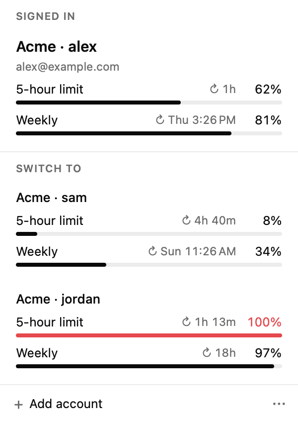
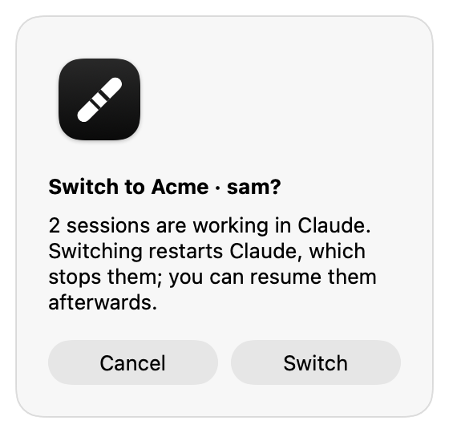
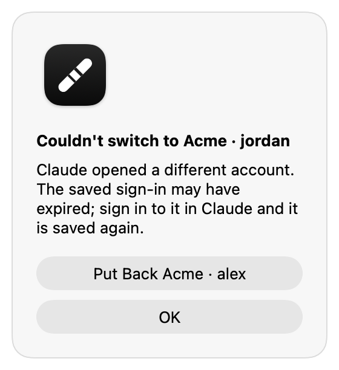
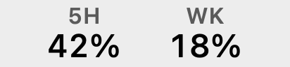

# Claude Desktop Baton

A macOS menu bar app for people who use several Claude accounts in the Claude
Desktop app. It switches Claude Desktop to another saved account in one click,
shows each account's usage, and hands your Claude Code sessions over to the
account you switch to, like passing a baton.

> **Unofficial.** Claude Desktop Baton is not affiliated with or endorsed by
> Anthropic. It relies on how Claude Desktop stores its data, which is
> undocumented and can change with any update.

<p align="center">
  <picture>
    <source media="(prefers-color-scheme: dark)" srcset="docs/images/panel-dark.png">
    
  </picture>
</p>

## What it does

- **One-click switching.** Pick an account in the menu bar panel. Claude quits,
  your Code sessions are synced, the account's saved sign-in is put in place,
  and Claude reopens signed in to it.
- **Sessions follow you, only when you switch.** Claude Desktop lists Code-tab
  sessions per account. At each switch, while Claude is closed, the app copies
  session entries between accounts: every active session, and archived ones
  active in the last 30 days. Sessions you delete in Claude are removed from the
  other accounts too. Nothing is touched while you are not switching.
- **Remote Control sessions follow too.** Sessions run by a Remote Control
  server (`claude remote-control`) are listed by the account that started the
  server, not as Code-tab entries. After a switch, the app opens each running
  one in Claude the way Claude Code's `/desktop` does, so it is listed under
  the new account and follows every later switch like any other session.
- **Usage at a glance.** Each account shows how much of its current session
  (5-hour) and weekly limits is used. A reached limit turns red with the time
  until it resets.
- **Asks before stopping work.** If a Code session was active in the last two
  minutes, switching asks first, because restarting Claude stops running work.
  If a switch fails, you can put the previous account back in one click.
- **Signed-in account first.** The panel shows the signed-in account on top and
  the accounts you can switch to below.
- **The terminal follows too.** A switch also moves the Claude Code CLI
  (`claude` in a terminal) to the same account, including sessions already
  running. Sign in once per account with `/login` in a terminal; the app saves
  it. The account the CLI is on carries a `CLI` tag in the panel.
- **A command line for agents.** `claude-desktop-baton accounts | status |
  usage | switch <account> | switch --best` lets agents and scripts see usage
  and ask for a switch, with `--json` output. Install it from the panel's `⋯`
  menu; `claude-desktop-baton help` explains the rest.
- **Updates itself.** About once a day it checks for a new version. When one is
  out, the menu bar item gets a small dot and the panel shows **Update available** with
  an **Install…** button; nothing pops up on its own. An update never restarts
  the app in the middle of a switch.

<p align="center">
  <picture>
    <source media="(prefers-color-scheme: dark)" srcset="docs/images/alert-confirm-dark.png">
    
  </picture>
  &nbsp;
  <picture>
    <source media="(prefers-color-scheme: dark)" srcset="docs/images/alert-failed-dark.png">
    
  </picture>
</p>

In the menu bar it shows the signed-in account's usage: a two-bar meter
(Session on top, Week below) and the Session percent. When a limit is
reached, the percent becomes the time until you can use Claude again.



## Requirements

- macOS 26 or later, Apple silicon
- [Claude Desktop](https://claude.ai/download)

## Install

Download `ClaudeDesktopBaton-<version>.dmg` from
[Releases](../../releases), open it, and drag **Claude Desktop Baton** to
Applications. The app is signed with a Developer ID and notarized by Apple,
so it opens without a Gatekeeper warning.

On first launch:

1. Click the item in the menu bar to open the panel. The app starts at login
   by default; turn this off in the panel's `⋯` menu.
2. The account Claude is signed in to is saved automatically. For each other
   account, choose **Add account**: Claude reopens signed out on this Mac only,
   you sign in, and it is saved.
3. When macOS asks whether Claude Desktop Baton may use "Claude Safe Storage",
   choose **Always Allow**. This is how it reads each account's usage.
4. To have the terminal follow switches, run `claude` and `/login` once as each
   account, opening the panel after each sign-in so it is saved.

Do not use Claude's own **Log Out** for a saved account: it most likely ends
that session on Anthropic's side, and the saved copy stops working.

### Updating

Versions after 0.2.0 update themselves: choose **Install…** in the panel,
or **Check for Updates…** in the `⋯` menu, and it downloads, verifies, replaces
itself, and reopens. Saved accounts, the Keychain approval, launch at login, and
the `claude-desktop-baton` command carry over. **Version 0.2.0 and earlier
cannot update themselves**: download the new DMG once and drag it over the old
app in Applications.

## What it touches

| What | When |
|---|---|
| `~/Library/Application Support/Claude/config.json`: `oauth:tokenCache`, `oauth:tokenCacheV2`, `lastKnownAccountUuid` | Read on save; replaced during a switch, with Claude closed |
| `~/Library/Application Support/Claude/Cookies`: `claude.ai` rows | Read on save; replaced during a switch, in one transaction |
| `~/Library/Application Support/Claude/claude-code-sessions/` | Session entries copied or moved to the app's trash during a switch, with Claude closed |
| `~/Library/Logs/Claude/main.log` | Read to tell which account Claude has loaded |
| `~/.claude/projects/` | File times read to tell which sessions are working |
| `~/.claude/sessions/` | Read to find the Remote Control sessions running on this Mac; never changed |
| `claude://resume?session=<id>` | Opened in Claude after a switch, once per running Remote Control session Claude does not list yet |
| Keychain item "Claude Safe Storage" | Read to decrypt session cookies in memory for usage requests |
| `https://claude.ai/api/organizations/<org>/usage`, `/api/account` | Usage and account names |
| Keychain item "Claude Code-credentials" (the CLI's login) | Its `claudeAiOauth` entry read to save each account's CLI sign-in, and replaced during a switch under Claude Code's own locks; its MCP tokens are left as they are |
| `~/.claude.json`: `oauthAccount` | Read to tell which account the CLI is on; replaced during a switch |
| `~/.claude/.oauth_refresh.lock`, `~/.claude.lock`, `~/.claude.json.lock` | Taken briefly during a switch, as Claude Code does |
| Keychain items "Claude Desktop Baton CLI sign-in" | Each account's saved CLI sign-in |
| `~/Library/Application Support/Claude Desktop Baton/` | Saved accounts (still encrypted with Claude's key), the previous sign-in, staging, trash, usage cache, and the socket the command line talks to |
| `~/.local/bin/claude-desktop-baton` | A link to the app, created only when you choose Install Command Line Tool |
| `https://github.com/toy-crane/claude-desktop-baton/releases/latest/download/appcast.xml` | The update feed, read about once a day and on Check for Updates; nothing about your Mac is sent with it |

Claude.app itself is never modified, decrypted values are never written to
disk, and sign-ins are only swapped while Claude is closed. Sessions removed
by a sync go to the app's own trash, not the system's.

## Limits

- Switching restarts Claude, so running Code sessions stop; they stay listed
  and can be resumed.
- Changing accounts through Claude's own sign-in screen does not sync sessions.
- Cowork sessions, cloud sessions, artifacts and scheduled tasks stay with the
  account that created them. A session's Remote Control setting travels with
  it, but its remote connection may need to be re-established.
- A Remote Control session opened in Claude keeps running under its server
  too. Use it from one place at a time: two programs writing the same
  conversation can damage it. The first switch after starting such sessions
  opens each of them in Claude once.
- A newly added account lists the other accounts' sessions from its next
  switch-in on.
- The CLI moves only to accounts whose CLI sign-in is saved; otherwise it stays
  where it is and an alert says so. Config folders chosen with
  `CLAUDE_CONFIG_DIR` are not touched.
- The claude.ai website in your browser is not switched.

## Build from source

```bash
swift test                   # unit tests
scripts/build-app.sh install # build, sign with your Apple Development identity, install, open
scripts/release.sh           # Developer ID signing, notarization, stapling, zip, DMG, update feed
```

A release needs its notes in `release-notes/<version>.md` (shown in the update
window and used for the GitHub release) and the Sparkle update signing key in
the login Keychain. `release.sh` prints the `gh release create` command that
publishes the zip, the DMG, and `appcast.xml` together; installed copies read
the feed from the latest release, so every release must carry it. Updates are
built with [Sparkle](https://sparkle-project.org); see
[docs/decisions/app-updates.md](docs/decisions/app-updates.md).

`claude-desktop-baton status` (or `ClaudeDesktopBaton --status`) previews what
a switch would sync without changing anything. The product contract is in
[docs/specs/claude-desktop-baton/spec.md](docs/specs/claude-desktop-baton/spec.md),
and the sync rules in [docs/decisions/session-sync.md](docs/decisions/session-sync.md).

The idea of switching sign-ins and copying session entries comes from
[claude-desktop-accounts](https://github.com/5eanxlee/claude-desktop-accounts);
this is an independent implementation.

## License

MIT. Claude is a trademark of Anthropic, PBC.
