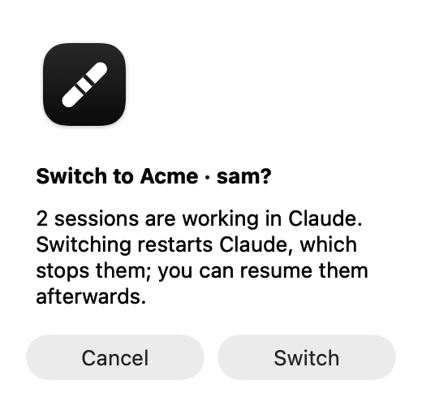

# Claude Desktop Baton

A macOS menu bar app for people who use several Claude accounts in the Claude
Desktop app. It switches Claude Desktop to another saved account in one click,
shows each account's usage, and hands your Claude Code sessions over to the
account you switch to, like passing a baton.

> **Unofficial.** Claude Desktop Baton is not affiliated with or endorsed by
> Anthropic. It relies on how Claude Desktop stores its data, which is
> undocumented and can change with any update.

<p align="center">
  <picture>
    <source media="(prefers-color-scheme: dark)" srcset="docs/images/panel-dark.png">
    
  </picture>
</p>

## What it does

- **One-click switching.** Pick an account in the menu bar panel. Claude quits,
  your Code sessions are synced, the account's saved sign-in is put in place,
  and Claude reopens signed in to it.
- **Sessions follow you, only when you switch.** Claude Desktop lists Code-tab
  sessions per account. At each switch, while Claude is closed, the app copies
  session entries between accounts: every active session, and archived ones
  active in the last 30 days. Sessions you delete in Claude are removed from the
  other accounts too. Nothing is touched while you are not switching.
- **Usage at a glance.** Each account shows how much of its current session
  (5-hour) and weekly limits is used. A reached limit turns red with the time
  until it resets.
- **Asks before stopping work.** If a Code session was active in the last two
  minutes, switching asks first, because restarting Claude stops running work.
  If a switch fails, you can put the previous account back in one click.
- **Signed-in account first.** The panel shows the signed-in account on top and
  the accounts you can switch to below.

<p align="center">
  
  &nbsp;
  
</p>

It lives in the menu bar as a baton:


## Requirements

- macOS 26 or later, Apple silicon
- [Claude Desktop](https://claude.ai/download)

## Install

Download `ClaudeDesktopBaton-<version>.zip` from
[Releases](../../releases), unzip it, and move **Claude Desktop Baton** to
Applications. The app is signed with a Developer ID and notarized by Apple,
so it opens without a Gatekeeper warning.

On first launch:

1. Click the baton in the menu bar to open the panel. The app starts at login
   by default; turn this off in the panel's `⋯` menu.
2. The account Claude is signed in to is saved automatically. For each other
   account, choose **Add account**: Claude reopens signed out on this Mac only,
   you sign in, and it is saved.
3. When macOS asks whether Claude Desktop Baton may use "Claude Safe Storage",
   choose **Always Allow**. This is how it reads each account's usage.

Do not use Claude's own **Log Out** for a saved account: it most likely ends
that session on Anthropic's side, and the saved copy stops working.

## What it touches

| What | When |
|---|---|
| `~/Library/Application Support/Claude/config.json`: `oauth:tokenCache`, `oauth:tokenCacheV2`, `lastKnownAccountUuid` | Read on save; replaced during a switch, with Claude closed |
| `~/Library/Application Support/Claude/Cookies`: `claude.ai` rows | Read on save; replaced during a switch, in one transaction |
| `~/Library/Application Support/Claude/claude-code-sessions/` | Session entries copied or moved to the app's trash during a switch, with Claude closed |
| `~/Library/Logs/Claude/main.log` | Read to tell which account Claude has loaded |
| `~/.claude/projects/` | File times read to tell which sessions are working |
| Keychain item "Claude Safe Storage" | Read to decrypt session cookies in memory for usage requests |
| `https://claude.ai/api/organizations/<org>/usage`, `/api/account` | Usage and account names |
| `~/Library/Application Support/Claude Desktop Baton/` | Saved accounts (still encrypted with Claude's key), the previous sign-in, staging and trash |

Claude.app itself is never modified, decrypted values are never written to
disk, and sign-ins are only swapped while Claude is closed. Sessions removed
by a sync go to the app's own trash, not the system's.

## Limits

- Switching restarts Claude, so running Code sessions stop; they stay listed
  and can be resumed.
- Changing accounts through Claude's own sign-in screen does not sync sessions.
- Cowork sessions, cloud sessions, artifacts and scheduled tasks stay with the
  account that created them. A session's Remote Control setting travels with
  it, but its remote connection may need to be re-established.
- A newly added account lists the other accounts' sessions from its next
  switch-in on.

## Build from source

```bash
swift test                   # unit tests
scripts/build-app.sh install # build, sign with your Apple Development identity, install, open
scripts/release.sh           # Developer ID signing, notarization, stapling, zip
```

`ClaudeDesktopBaton --status` previews what a switch would sync without
changing anything. The product contract is in
[docs/specs/claude-desktop-baton/spec.md](docs/specs/claude-desktop-baton/spec.md),
and the sync rules in [docs/decisions/session-sync.md](docs/decisions/session-sync.md).

The idea of switching sign-ins and copying session entries comes from
[claude-desktop-accounts](https://github.com/5eanxlee/claude-desktop-accounts);
this is an independent implementation.

## License

MIT. Claude is a trademark of Anthropic, PBC.
